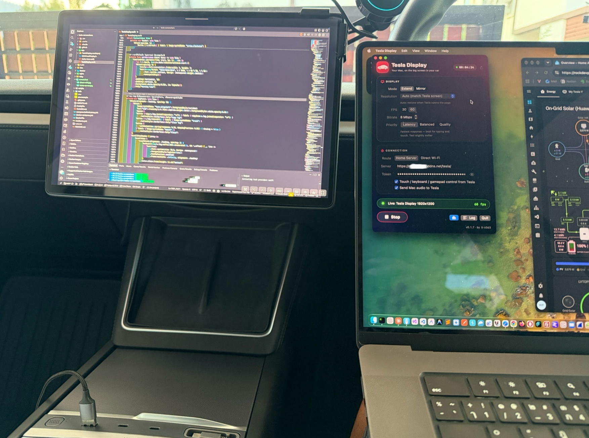
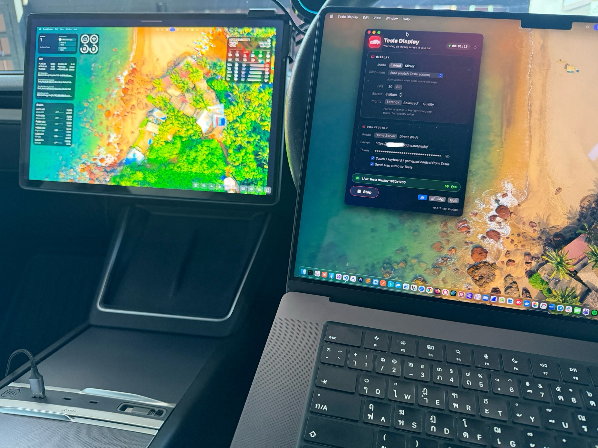
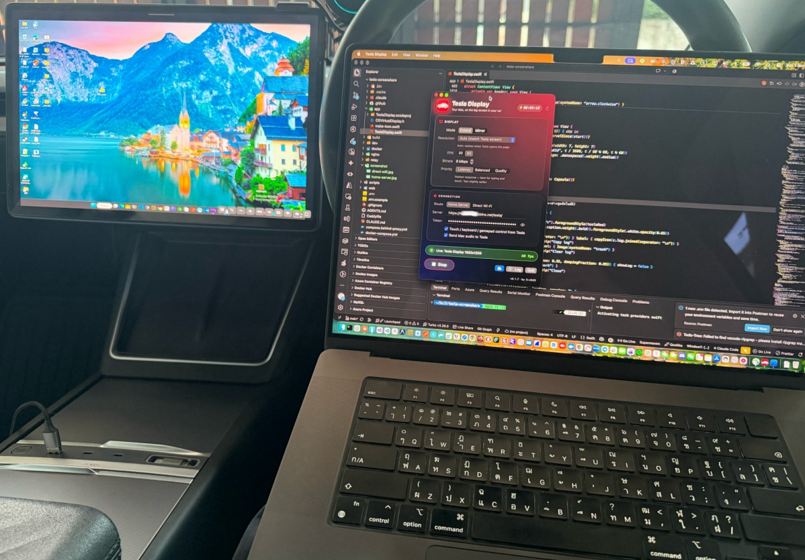
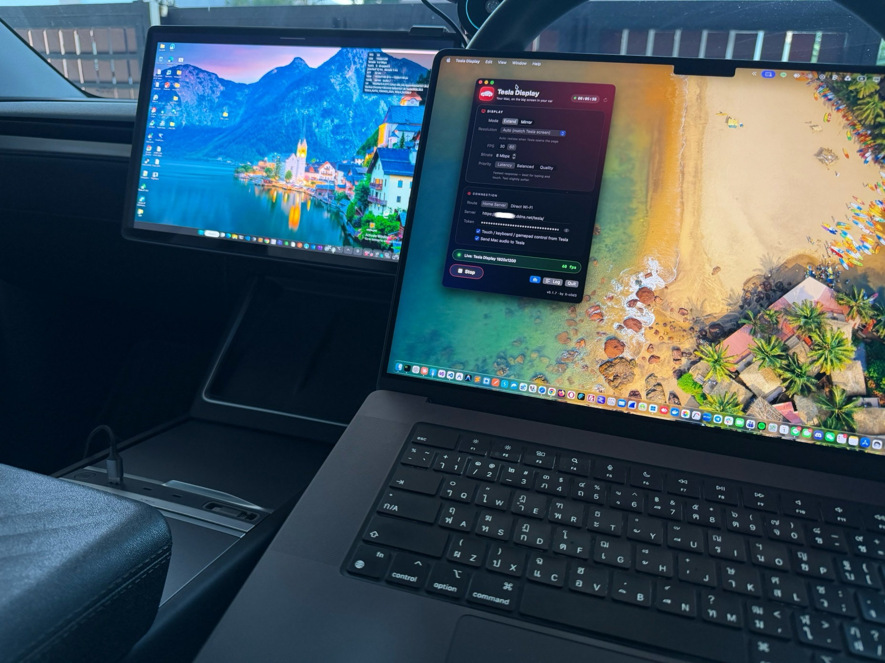
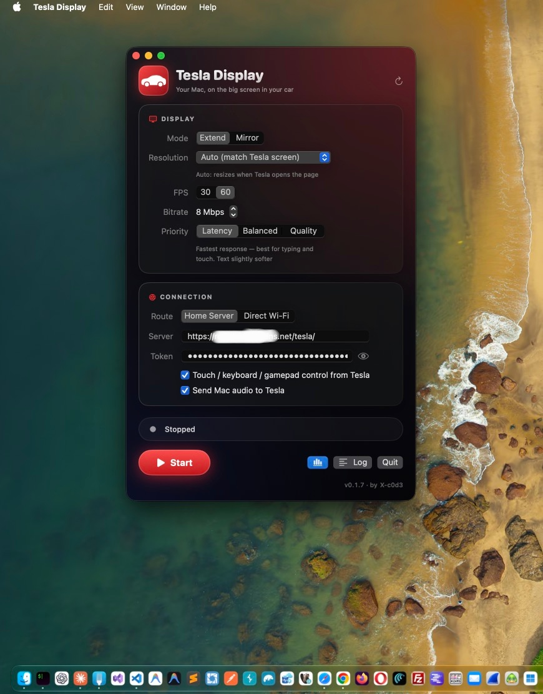
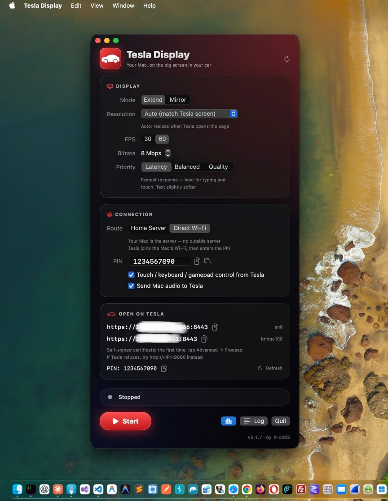

# Tesla Display

ใช้จอกลางของ Tesla เป็น**จอที่ 2 ของ MacBook** ผ่าน browser ของรถ สำหรับนั่งทำงานในรถตอนจอด

- **Extend** — Tesla เป็นจอที่ 2 จริง ลากหน้าต่างไปวางได้ (แอปสร้างจอเสมือนให้เอง) หรือ **Mirror** จอที่มีอยู่
- **แตะ / พิมพ์บนจอ Tesla** เพื่อควบคุม Mac (click, drag, scroll, คีย์บอร์ดไทย/อังกฤษ, คีย์ลัด)
- **เสียงจาก Mac ออกลำโพงรถ** และ **จอยเกมที่ต่อกับรถ** ใช้ควบคุม Mac ได้ (แปลงเป็นคีย์บอร์ด/เมาส์)
- **WebRTC + H.264** — ภาพลื่นกว่า Guacamole/VNC มาก
- **บน Tesla ไม่ต้องติดตั้งอะไร** แค่เปิด URL ใน browser
- 2 เส้นทาง: **Direct Wi-Fi** (ภาพวิ่งตรงใน Wi-Fi/hotspot เดียวกัน, server แค่จับคู่) หรือ **Home Server** (ภาพผ่าน server ของคุณ ใช้ได้ทุกที่)
- ส่งจาก **iPad / iPhone** ได้ด้วย (ดูอย่างเดียว ผ่าน Home Server)



| Extend — จอที่ 2 จริง | ลากหน้าต่างไปวางบนจอรถ | 1920x1200 @ 60 fps |
| :---: | :---: | :---: |
|  |  |  |

> Not affiliated with or endorsed by Tesla, Inc. — "Tesla" is a trademark of Tesla, Inc.

## สารบัญ

1. [ทำงานยังไง](#ทำงานยังไง)
2. [สิ่งที่ต้องมี](#สิ่งที่ต้องมี)
3. [ติดตั้งแอปบน Mac](#1-ติดตั้งแอปบน-mac)
4. [หน้าแอป](#2-หน้าแอป)
5. [ใช้แบบ Direct Wi-Fi](#3-ใช้แบบ-direct-wi-fi-ภาพวิ่งตรง-server-แค่จับคู่)
6. [ใช้แบบ Home Server](#4-ใช้แบบ-home-server-server-ของคุณเอง-nas-ที่บ้าน--vps--oracle-cloud)
7. [ควบคุมบน Tesla](#5-ควบคุมบน-tesla)
8. [ส่งจาก iPad / iPhone](#6-ส่งจาก-ipad--iphone-ดูอย่างเดียว)
9. [ค่าที่แนะนำ](#7-ค่าที่แนะนำ)
10. [ความปลอดภัย](#8-ความปลอดภัย)

## ทำงานยังไง

**Direct Wi-Fi** — Mac กับ Tesla อยู่ Wi-Fi / hotspot มือถือวงเดียวกัน ภาพวิ่งตรง Mac → รถ (latency ต่ำสุด ไม่กินเน็ตมือถือเรื่องภาพ)

```
Tesla browser ──https://<pair server>/──► Pair server (หน้าเว็บ + จับคู่ด้วย PIN + ส่งต่อแตะ/พิมพ์) ◄──WS── Mac agent
      ▲                                                                                              │
      └═══════════════ WebRTC ภาพ/เสียง ตรงใน Wi-Fi วงเดียวกัน (UDP 8189) ═══════════ Mac: mediamtx ◄─┘
```

Tesla ไม่ยอมเปิด URL ที่เป็น IP และไม่รับใบรับรอง self-signed → หน้าเว็บต้องมาจาก domain จริง (pair server)
แต่ WebRTC ต่อไปหา IP ใน LAN ได้ จึงให้ server ทำแค่ "นัดเจอ" แล้วภาพไม่ผ่าน server เลย

**Home Server** — ภาพวิ่งผ่าน NAS ที่บ้าน (Mac กับรถอยู่คนละที่ได้)

```
Mac ──WHIP──► NAS: Caddy + mediamtx + input relay ──WHEP──► Tesla browser
Mac ◄──WS (แตะ/พิมพ์)────────────────────────────────WS──── Tesla browser
```

Mac เป็นฝ่ายต่อออกไปหา NAS เอง จึงไม่ต้องเปิดพอร์ตฝั่ง Mac / hotspot

## สิ่งที่ต้องมี

|                          | Direct Wi-Fi                                                       | Home Server                                     |
| ------------------------ | ------------------------------------------------------------------ | ----------------------------------------------- |
| Mac                      | macOS 15+, Apple Silicon หรือ Intel                                | เหมือนกัน                                       |
| ffmpeg                   | `brew install ffmpeg` (เวอร์ชัน 8 ขึ้นไป)                          | เหมือนกัน                                       |
| Xcode Command Line Tools | สำหรับ build แอป (`xcode-select --install`)                        | เหมือนกัน                                       |
| เน็ต                     | Mac กับรถต่อ Wi-Fi/hotspot วงเดียวกัน และออกเน็ตได้ (โหลดหน้า + จับคู่) | Mac และรถต้องออกเน็ตได้                         |
| Server                   | Pair server (ใช้ของคนอื่นที่เปิดให้ หรือรันเอง: container เล็กๆ ไม่ต้องเปิด UDP) | NAS/เครื่องที่รัน Docker + โดเมน + port-forward |

## 1. ติดตั้งแอปบน Mac

### แบบที่ 1 — ดาวน์โหลดจาก Releases (ง่ายสุด ไม่ต้อง build)

1. ติดตั้ง ffmpeg: `brew install ffmpeg` (ต้องมี [Homebrew](https://brew.sh))
2. ดาวน์โหลด **Tesla-Display-v…-macOS.zip** จาก [Releases](https://github.com/X-c0d3/tesla-display/releases/latest)
   → แตกไฟล์ → ลาก **Tesla Display.app** ไปไว้ใน **Applications** (ใช้ได้ทั้ง Apple Silicon และ Intel, macOS 15+)
3. แอปไม่ได้ผ่าน notarization ของ Apple — เปิดครั้งแรกให้รันคำสั่งนี้ก่อน:

```bash
   xattr -dr com.apple.quarantine "/Applications/Tesla Display.app"
```

(หรือเปิดแอป 1 ครั้ง แล้วไปที่ System Settings → Privacy &amp; Security → **Open Anyway**) 4. ให้สิทธิ์ตามหัวข้อ "ให้สิทธิ์ครั้งแรก" ด้านล่าง

### แบบที่ 2 — build เอง

```bash
git clone https://github.com/X-c0d3/tesla-display.git
cd tesla-display
./scripts/build-app.sh --install
```

`build-app.sh --install` ทำครบในคำสั่งเดียว: ปิดแอปเดิม → compile → คัดลอกไป `/Applications` → เปิดแอป
(ครั้งแรกจะดาวน์โหลด mediamtx พร้อมตรวจ checksum มาใส่ในแอปให้เอง — `PAIR_URL=https://…/pair ./scripts/build-app.sh` = ตั้งค่าเริ่มต้นของ Pair server)

**อัปเดตเป็นเวอร์ชันล่าสุด:**

```bash
cd tesla-display && git pull && ./scripts/build-app.sh --install
```

แก้โค้ดเองก็รัน `./scripts/build-app.sh --install` ซ้ำได้เลย — ถ้าอยาก build อย่างเดียวไม่ติดตั้ง ใช้ `./scripts/build-app.sh`

**ให้สิทธิ์ครั้งแรก** (System Settings &gt; Privacy &amp; Security):

1. **Screen &amp; System Audio Recording** → เปิด _Tesla Display_
2. **Accessibility** → เปิด _Tesla Display_ (สำหรับรับการแตะ/พิมพ์จากรถ)
3. **Quit แล้วเปิดแอปใหม่** — macOS ใช้สิทธิ์ใหม่หลังเปิดแอปใหม่เท่านั้น
4. โหมด Direct Wi-Fi: ครั้งแรก macOS อาจถามให้ _mediamtx_ รับการเชื่อมต่อขาเข้า → **Allow** (ภาพ UDP จากรถ)

> build แอปใหม่ทุกครั้ง macOS จะมองเป็นแอปใหม่ (ad-hoc signature) — ถ้าส่งภาพไม่ได้หลัง build
> ให้ลบ _Tesla Display_ ออกจากรายการสิทธิ์ทั้งสองด้วยปุ่ม **−** แล้วเพิ่มใหม่ด้วย **+**

**แต่ง UI ใน Xcode (Preview):** เปิด `app/TeslaDisplay.xcodeproj` → เปิดไฟล์ `TeslaDisplay.swift` → Editor → Canvas (⌥⌘↩)
จะเห็นหน้าต่างแอปสดข้างโค้ด — โปรเจกต์นี้มีไว้ดู/แต่ง UI เท่านั้น (ปุ่ม Start ไม่ทำงานจริงใน Preview)
แอปที่ใช้งานจริงยัง build ด้วย `./scripts/build-app.sh` เหมือนเดิม

## 2. หน้าแอป

| Route: Home Server | Route: Direct Wi-Fi |
| :---: | :---: |
|  |  |

### Display

| ตัวเลือก                           | ความหมาย                                                                                                                                                                                                                                                                                   |
| ---------------------------------- | ------------------------------------------------------------------------------------------------------------------------------------------------------------------------------------------------------------------------------------------------------------------------------------------ |
| **Mode: Extend**                   | สร้างจอเสมือนชื่อ _Tesla Display_ — Tesla เป็นจอที่ 2 ลากหน้าต่างไปวางได้                                                                                                                                                                                                                  |
| **Mode: Mirror**                   | ส่งภาพจอที่มีอยู่ (เลือกจอใน _Screen_) — Tesla แสดงเหมือนจอนั้น                                                                                                                                                                                                                            |
| **Resolution: Auto** (ค่าเริ่มต้น) | เริ่มที่ 1920x1200 แล้วปรับให้ตรงพื้นที่หน้าเว็บบน Tesla อัตโนมัติ (ไม่รวมแถบ URL; กด full screen แล้วปรับใหม่ให้) แสดงขนาดที่วัดได้ใต้ตัวเลือก — ใช้ได้เฉพาะโหมด **Extend** (ภาพเต็มจอพอดี 1:1 ไม่มีขอบดำ; โหมด Mirror หน้าเว็บรักษาสัดส่วนจอ Mac จึงมีขอบดำถ้าสัดส่วนต่างจากจอรถเกิน 3%) |
| **Resolution: More workspace**     | 2304x1440 – 3840x2400 พื้นที่ทำงานมากขึ้น ตัวหนังสือเล็กลง                                                                                                                                                                                                                                 |
| **Resolution: Larger text**        | 1680x1050 – 1280x800 ตัวหนังสือใหญ่ขึ้น                                                                                                                                                                                                                                                    |
| **FPS**                            | 30 (แนะนำสำหรับทำงาน) / 60                                                                                                                                                                                                                                                                 |
| **Bitrate**                        | เพดานความเร็วภาพ 2–20 Mbps (ดู [ค่าที่แนะนำ](#7-ค่าที่แนะนำ))                                                                                                                                                                                                                              |
| **Priority**                       | **Latency** (ค่าเริ่มต้น) = keyframe เล็ก delay ต่ำสุด · **Balanced** · **Quality** = คมกว่าแต่ keyframe ใหญ่ อาจหน่วงเป็นจังหวะถ้า upload ช้า — เปลี่ยนแล้วกด Stop/Start ไม่ต้อง build ใหม่                                                                                               |
| **📈** (แถบล่าง)                   | เปิด/ปิดตัวเลข FPS · bitrate ที่ Mac กำลังส่งจริง (realtime ทุก 1 วินาที, ปิดเป็นค่าเริ่มต้น) — เทียบกับ 📊 บนรถเพื่อดูว่าเฟรมหายระหว่างทางไหม                                                                                                                                             |
| **Log** (แถบล่าง)                  | เปิด/ปิดแผง Log ที่เลื่อนออกทางขวา — สีแดง = error, ส้ม = กำลังต่อใหม่; copy / clear ได้                                                                                                                                                                                                   |

สลับ **Extend / Mirror ได้ระหว่างใช้งาน** แอปจะเริ่มใหม่ให้เอง (ภาพบนรถหายไป ~1–2 วินาที)
ภาพที่ส่งไปรถถูกจำกัดไว้ไม่เกิน 1920x1200 แม้จอเสมือนจะใหญ่กว่า (ประหยัด bitrate)

### Connection

| ตัวเลือก                                          | ความหมาย                                                                                        |
| ------------------------------------------------- | ----------------------------------------------------------------------------------------------- |
| **Route: Direct Wi-Fi**                           | ภาพวิ่งตรงใน Wi-Fi วงเดียวกัน — **PIN** (≥ 6 ตัว, สุ่มให้, กด 🎲 สุ่มใหม่) = รหัสจับคู่ + PIN ควบคุม, **Pair server** = URL ที่รถเปิด |
| **Route: Home Server**                            | ส่งผ่าน NAS — ใส่ **Server** (`https://<โดเมน>`) และ **Token** (`PUBLISH_TOKEN`, กด 👁 เพื่อดู) |
| **Touch / keyboard / gamepad control from Tesla** | ปิดถ้าต้องการให้รถดูอย่างเดียว                                                                  |
| **Send Mac audio to Tesla**                       | ส่งเสียงระบบของ Mac (Opus 128 kbps) ไปออกลำโพงรถ                                                |

### Open on Tesla (เฉพาะ Direct Wi-Fi)

แสดง URL ของ Pair server ที่ต้องเปิดบนรถ และ PIN พร้อมปุ่ม copy

### แถบล่าง

- **สถานะ** — เทา = Stopped, เขียว (เต้น) = Live, ส้ม = กำลังต่อใหม่
- **ตัวนับเวลา** มุมขวาบน — เวลาที่รันไปแล้วตั้งแต่กด Start
- **Start / Stop**, **Log** (ดูข้อความจาก ffmpeg / agent / server), **Quit** (หยุดทุกอย่างแล้วปิดแอป)

แอปต่อใหม่เองทุก 3 วินาทีเมื่อเน็ตหลุด และจำค่าทั้งหมดไว้ (เปิดครั้งหน้าไม่ต้องตั้งใหม่)

## 3. ใช้แบบ Direct Wi-Fi (ภาพวิ่งตรง, server แค่จับคู่)

1. **Mac และ Tesla ต่อ Wi-Fi วงเดียวกัน** — ง่ายสุดคือ hotspot มือถือ (เปิด hotspot แล้วให้ทั้ง Mac และรถต่อ)
   - หรือ Mac เปิด **Internet Sharing** (แชร์เน็ตจาก iPhone USB / Ethernet ออกเป็น Wi-Fi) แล้วให้รถต่อ Wi-Fi ของ Mac
   - hotspot ต้องไม่กั้นเครื่องในวงคุยกันเอง (client isolation) และต้องออกเน็ตได้
2. **แอป** → Route **Direct Wi-Fi** → ใส่ **Pair server** (ถ้ายังว่าง) → กด **Start**
3. **Tesla browser** → เปิด URL ของ Pair server (จากการ์ด _Open on Tesla_) → หน้าเว็บพาเข้าเต็มจอผ่าน YouTube เอง
4. ใส่ **PIN** → มุมซ้ายบนขึ้น `live (direct)`

- ขึ้น _no Mac online with this PIN_ = PIN ผิด หรือ Mac ยังไม่กด Start (server ไม่บอกว่าแบบไหน เพื่อกันเดา PIN)
- ขึ้น _can't reach the Mac_ = รถกับ Mac อยู่คนละวง หรือ hotspot กั้นเครื่องคุยกัน
- ภาพ/เสียงไม่ผ่าน server แต่ **แตะ/พิมพ์ยังส่งผ่าน pair server** (หน้าเว็บ https คุยกับ Mac ใน LAN ตรงๆ ไม่ได้)

### รัน Pair server เอง (ไม่บังคับ)

container แยกจาก Home Server (`/tesla/` เดิมไม่กระทบ ปิด/เปิดได้อิสระ) — รับแค่ข้อความจับคู่ + แตะ/พิมพ์ ไม่รับภาพ ไม่ต้องเปิด UDP

```bash
git pull
docker compose -f compose.pair.yml up -d --build      # ฟังที่พอร์ต 8090 (เปลี่ยนด้วย PAIR_PORT ใน .env)
curl -s http://127.0.0.1:8090/ | grep -o '<html[^>]*>' # ต้องได้ <html lang="en" data-mode="pair">
```

- project แยกชื่อ `tesla-pair` — ไม่ยุ่งกับ container `tesla-display` เดิม (ใช้กับ server จริงได้เลย ไม่ต้องมี override ของ Colima)
- ให้ nginx ส่ง `https://<โดเมน>/pair/` → `http://<เครื่องนี้>:8090/` (ตัวอย่างใน `nginx/tesla-display-prefix.conf`)
  nginx ใน docker → ใช้ IP ของ server แทน `127.0.0.1` ใน `proxy_pass` (แบบเดียวกับ `/tesla/`) แล้ว `nginx -t` + reload
- ทดสอบ: เปิด `https://<โดเมน>/pair/?fs=1` → ต้องขึ้นช่องใส่ PIN · ในแอปตั้ง **Pair server** = `https://<โดเมน>/pair`
- ไม่ต้องเปิด UDP และไม่ต้องเปิดพอร์ต 8090 สู่อินเทอร์เน็ต (ขอแค่ nginx เข้าถึงได้)
- อัปเดต: `git pull` แล้วรันคำสั่ง `up -d --build` ข้างบนซ้ำ (หน้าเว็บกับ `relay/pair.py` ฝังอยู่ใน image)
- ดู log: `docker compose -f compose.pair.yml logs -f`
- ปิดให้คนอื่นใช้ = ลบ location `/pair/` ออกจาก nginx หรือ `docker compose -f compose.pair.yml down`

## 4. ใช้แบบ Home Server (server ของคุณเอง: NAS ที่บ้าน / VPS / Oracle Cloud)

server เป็น **container เดียว** (`tesla-display`: mediamtx + Caddy + input relay ใน image เดียว)
ต้องมี `git`, Docker และ Docker Compose **v2.24 ขึ้นไป** (`docker compose version`)

### 4.1 เลือกแบบติดตั้งก่อน

|                       | **แบบ A — server ใช้พอร์ต 80/443 เอง**   | **แบบ B — อยู่หลัง nginx ที่มีอยู่แล้ว**                                          |
| --------------------- | ---------------------------------------- | --------------------------------------------------------------------------------- |
| ใช้เมื่อ              | เครื่องนี้ยังไม่มีเว็บอื่น / ไม่มี nginx | มี nginx ถือพอร์ต 80/443 อยู่แล้ว (มีเว็บอื่นอยู่บนโดเมนเดียวกัน)                 |
| HTTPS / ใบรับรอง      | Caddy ของเราขอ Let's Encrypt ให้เอง      | nginx เดิมจัดการ                                                                  |
| URL                   | `https://screen.example.com/`            | `https://home.example.com/tesla/` (prefix path) หรือ subdomain                    |
| คำสั่ง docker compose | `docker compose …`                       | `docker compose -f docker-compose.yml -f compose.behind-proxy.yml …` **ทุกครั้ง** |
| เปิดพอร์ต             | TCP 80, TCP 443, **UDP 8189**            | **UDP 8189** (80/443 เป็นของ nginx อยู่แล้ว)                                      |

> ⚠️ ถ้ามี nginx อยู่แล้วแต่รันแบบ A Caddy จะพยายามขอใบรับรองและใช้พอร์ต 443 เอง → ใช้งานไม่ได้

### 4.2 เตรียม server (ทั้งสองแบบ)

```bash
git clone https://github.com/X-c0d3/tesla-display.git /opt/tesla-display
cd /opt/tesla-display
cp .env.example .env
sed -i.bak "s/^PUBLISH_TOKEN=.*/PUBLISH_TOKEN=$(openssl rand -hex 24)/" .env && rm .env.bak
nano .env          # ใส่ DOMAIN และ CONTROL_PIN
```

| ค่าใน `.env`    | ใส่อะไร                                                                                                   |
| --------------- | --------------------------------------------------------------------------------------------------------- |
| `DOMAIN`        | โดเมนที่ชี้มาที่ server (A record → public IP) **ไม่ต้องมี** `**https://**` **และไม่ต้องมี** `**/tesla**` |
| `PUBLISH_TOKEN` | สุ่มด้วยคำสั่ง `sed` ข้างบน — ใส่ค่าเดียวกันในช่อง Token ของแอป                                           |
| `CONTROL_PIN`   | PIN ที่พิมพ์บน Tesla (อย่างน้อย 6 ตัว แนะนำ 10 ตัวขึ้นไป)                                                 |
| `PROXY_PORT`    | (แบบ B, ไม่บังคับ) พอร์ต HTTP ที่ nginx จะส่งต่อมา ค่าเริ่มต้น 8088                                       |

Proxmox LXC ต้องเปิด `nesting=1,keyctl=1`

### 4.3 แบบ A — server ใช้พอร์ต 80/443 เอง

```bash
cd /opt/tesla-display
docker compose up -d --build
docker compose logs -f         # รอบรรทัด [caddy] … "certificate obtained" แล้วกด Ctrl+C
```

ใช้งาน: แอปบน Mac → Server `https://<DOMAIN>` · Tesla เปิด `https://<DOMAIN>/`

### 4.4 แบบ B — อยู่หลัง nginx เดิม + prefix path (เช่น `https://home.example.com/tesla/`)

```
Tesla / Mac ──https://home.example.com/tesla/──► nginx (เดิม, ถือใบรับรอง) ──http──► <server>:8088 (Caddy ของเรา) ──► mediamtx / relay
Tesla / Mac ◄════════════ UDP 8189 (ภาพ+เสียง WebRTC, ไม่ผ่าน nginx) ═══════════════► <server>:8189 (mediamtx)
```

nginx ส่งต่อแค่หน้าเว็บ, signalling (WHIP/WHEP) และ WebSocket (แตะ/พิมพ์/จอย) — ภาพไม่ผ่าน nginx จึงไม่ทำให้ช้าลง

#### ขั้นที่ 1 — รัน container

```bash
cd /opt/tesla-display
docker compose -f docker-compose.yml -f compose.behind-proxy.yml up -d --build
docker ps --filter name=tesla-display --format '{{.Status}} | {{.Ports}}'   # ต้องเห็น …:8088->80/tcp, …:8189->8189/udp
curl -s -o /dev/null -w "%{http_code}\n" http://localhost:8088/                # ต้องได้ 200
```

`compose.behind-proxy.yml` ทำให้ Caddy ของเราเป็น HTTP ธรรมดาบนพอร์ต 8088 (ไม่ขอใบรับรอง ไม่แย่งพอร์ต 80/443 ของ nginx)

#### ขั้นที่ 2 — เพิ่ม location ใน nginx

ตัวอย่างเต็มอยู่ที่ [nginx/tesla-display-prefix.conf](nginx/tesla-display-prefix.conf)
(มี subdomain แยกให้ระบบนี้ เช่น `screen.example.com` → ใช้ [nginx/tesla-display.conf](nginx/tesla-display.conf) แทน)

**2.1** ระดับ `http { }` (เช่นไฟล์ใน `conf.d/`) — ข้ามได้ถ้า config หลักมี `map $http_upgrade` อยู่แล้ว (ประกาศซ้ำจะ error):

```nginx
map $http_upgrade $connection_upgrade {
    default upgrade;
    ''      close;
}
```

**2.2** ใน `server { }` เดิมของ `home.example.com` (บล็อก `listen 443 ssl`) เพิ่ม:

```nginx
location = /tesla {
    return 301 /tesla/;
}

location /tesla/ {
    proxy_pass http://127.0.0.1:8088/;          # nginx เครื่องเดียวกัน = 127.0.0.1 / คนละเครื่อง = IP ของ server : PROXY_PORT
                                                # ("/" ท้าย = ตัด /tesla ออกก่อนส่งต่อ)
    proxy_redirect / /tesla/;                   # เติม /tesla กลับใน header Location
    proxy_http_version 1.1;
    proxy_set_header Host $host;
    proxy_set_header X-Forwarded-For $proxy_add_x_forwarded_for;
    proxy_set_header X-Forwarded-Proto https;
    proxy_set_header X-Forwarded-Prefix /tesla;
    proxy_set_header Upgrade $http_upgrade;     # WebSocket (แตะ/พิมพ์/จอย)
    proxy_set_header Connection $connection_upgrade;
    proxy_read_timeout 1h;                      # ไม่ตัด WebSocket เมื่อไม่ได้แตะจอนาน
    proxy_send_timeout 1h;
    proxy_buffering off;
    client_max_body_size 1m;
}
```

- nginx รันใน docker → ห้ามใช้ `127.0.0.1` (จะหมายถึง container ของ nginx เอง) ให้ใช้ IP ของเครื่อง
- อยากใช้ชื่ออื่นแทน `/tesla` ต้องแก้ให้ตรงกันทั้ง 4 ที่: `location = /tesla`, `return 301`, `location /tesla/`, `proxy_redirect`

**2.3** ตรวจและโหลด config ใหม่:

```bash
nginx -t && nginx -s reload
# nginx ใน docker: docker exec <container> nginx -t && docker exec <container> nginx -s reload
```

#### ขั้นที่ 3 — ตรวจสอบ (จากเครื่องอื่น เช่นมือถือปิด Wi-Fi)

```bash
curl -s -o /dev/null -w "%{http_code}\n" https://home.example.com/tesla/                       # 200
curl -s -o /dev/null -w "%{http_code}\n" -X POST https://home.example.com/tesla/screen/whip    # 401 (ไม่มี token = ถูกต้อง)
curl -si -H "Connection: Upgrade" -H "Upgrade: websocket" -H "Sec-WebSocket-Version: 13" \
  -H "Sec-WebSocket-Key: dGVzdA==" https://home.example.com/tesla/input/viewer | head -1       # HTTP/1.1 101 Switching Protocols
```

#### ใช้งาน

|                                            | ใส่อะไร                                                            |
| ------------------------------------------ | ------------------------------------------------------------------ |
| แอปบน Mac → Route **Home Server** → Server | `https://home.example.com/tesla` (มี `/` ท้ายหรือไม่ก็ได้)         |
| Token                                      | `PUBLISH_TOKEN`                                                    |
| Tesla browser                              | `https://home.example.com/tesla/` (แนะนำ bookmark)                 |
| iPad / Larix (WHIP)                        | `https://home.example.com/tesla/screen/whip?token=<PUBLISH_TOKEN>` |

### 4.5 เปิดพอร์ต / firewall

**UDP 8189 จำเป็นทุกแบบ** — ภาพและเสียงไม่ได้วิ่งผ่าน HTTPS แต่วิ่ง UDP ตรงไปที่ container
พอร์ตภายนอกกับภายในต้องเป็น 8189 ทั้งคู่ · TCP 8088 (แบบ B) **ห้ามเปิดออก internet**

| server อยู่ที่ไหน                           | ต้องเปิดตรงไหน                                                                                                                                                                                                                                                        |
| ------------------------------------------- | --------------------------------------------------------------------------------------------------------------------------------------------------------------------------------------------------------------------------------------------------------------------- |
| **NAS / เครื่องที่บ้าน**                    | 1) router: port-forward UDP 8189 (+ TCP 80/443 ถ้าแบบ A) → IP ของ server 2) Proxmox firewall / `ufw` ถ้าเปิดใช้                                                                                                                                                       |
| **Oracle Cloud**                            | 1) Console: Networking → VCN → Subnet → Security List (หรือ NSG ของ VNIC) → Add Ingress Rule: Source `0.0.0.0/0`, **IP Protocol UDP**, Destination Port **8189** 2) ใน VM: `sudo iptables -I INPUT 1 -p udp --dport 8189 -j ACCEPT && sudo netfilter-persistent save` |
| **VPS อื่น (AWS / GCP / DigitalOcean ฯลฯ)** | 1) Security Group / Cloud Firewall: UDP 8189 2) `ufw allow 8189/udp` ถ้าเปิด ufw อยู่                                                                                                                                                                                 |

ใช้ `iptables -L INPUT -n --line-numbers` ดูกฎปัจจุบันก่อน — ถ้า `-I INPUT <เลข>` ขึ้น `Index of insertion too big` ให้ใช้เลข `1`

**ทดสอบว่า UDP 8189 เปิดแล้ว** (telnet ใช้ไม่ได้ — telnet เป็น TCP):

```bash
# บน server: หยุด container ชั่วคราว แล้วเปิดฟังพอร์ต
docker compose stop && nc -u -l 8189
# บน Mac: พิมพ์ข้อความแล้วกด Enter — ถ้าข้อความไปโผล่ที่ server = firewall เปิดแล้ว
nc -u <PUBLIC-IP ของ server> 8189
# เสร็จแล้ว Ctrl+C ทั้งสองฝั่ง และเปิด container กลับ (แบบ B ใส่ -f … ด้วย)
docker compose start
```

### 4.6 คำสั่งที่ใช้บ่อย

|                                       | แบบ A                                      | แบบ B (หลัง nginx)                                                                           |
| ------------------------------------- | ------------------------------------------ | -------------------------------------------------------------------------------------------- |
| อัปเดตเป็นเวอร์ชันล่าสุด              | `git pull && docker compose up -d --build` | `git pull && docker compose -f docker-compose.yml -f compose.behind-proxy.yml up -d --build` |
| ดูสถานะ / พอร์ต                       | `docker compose ps`                        | `docker compose -f docker-compose.yml -f compose.behind-proxy.yml ps`                        |
| ดู log                                | `docker compose logs -f`                   | (เหมือนกัน) `docker compose logs -f`                                                         |
| restart (เช่น IP เปลี่ยน, แก้ `.env`) | `docker compose up -d`                     | `docker compose -f docker-compose.yml -f compose.behind-proxy.yml up -d`                     |
| หยุด                                  | `docker compose down`                      | `docker compose -f docker-compose.yml -f compose.behind-proxy.yml down`                      |

- `git pull` ไม่แตะ `.env` (อยู่ใน `.gitignore`)
- แก้ `web/`, `Caddyfile`, `mediamtx.yml`, `relay/` → ต้อง `up -d --build` (ไฟล์ถูกฝังใน image)
- `restart: unless-stopped` → เปิดเองหลังรีบูต (ต้อง `sudo systemctl enable docker`)

### 4.7 แก้ปัญหา server

| อาการ                                                                          | สาเหตุ / วิธีแก้                                                                                                        |
| ------------------------------------------------------------------------------ | ----------------------------------------------------------------------------------------------------------------------- |
| `docker ps` ไม่แสดงพอร์ต / container restart วน                                | ดู `docker compose logs --tail 40` — มี nginx อยู่แล้วแต่รันแบบ A? Docker Compose ต่ำกว่า v2.24 (`!override` ไม่ทำงาน)? |
| log `[caddy] … obtaining certificate` แต่มี nginx อยู่แล้ว                     | รันผิดแบบ → `docker compose down` แล้วรันแบบ B                                                                          |
| log `lookup … on 127.0.0.53:53 … connection refused`                           | DNS ใน container ใช้ไม่ได้ (เช็ก `docker run --rm alpine nslookup google.com`)                                          |
| `nginx -t`: `duplicate "connection_upgrade" variable`                          | มี `map` อยู่แล้ว → ลบบล็อก 2.1 ออก                                                                                     |
| `/tesla/` ได้ 502 Bad Gateway                                                  | nginx ไปไม่ถึง `<server>:8088` — เช็ก `proxy_pass`, container Up, firewall                                              |
| หน้าเว็บขึ้นแต่แตะ/พิมพ์ไม่ได้ / ไม่ได้ 101                                    | ขาด `proxy_http_version 1.1` / `Upgrade` / `Connection` หรือ `map`                                                      |
| แอปขึ้น `Disconnected (exit …)` วน                                             | Server URL (แบบ B ต้องมี `/tesla`) หรือ Token ไม่ตรง `.env` — ดู Log ในแอป                                              |
| log `created by …` แล้ว `closed: terminated` / Tesla ค้าง `waiting for video…` | UDP 8189 ไปไม่ถึง (firewall 4.5) หรือ `DOMAIN` ไม่ได้ชี้ public IP ของ server                                           |
| log `WebRTC doesn't support H264 streams with B-frames`                        | ผู้ส่ง (เช่นแอป iPad) ส่ง B-frames → ปิด B-frames ในแอปนั้น                                                             |
| เปิด `https://home.example.com/tesla` แล้วไปหน้าเว็บหลัก                       | ขาด `location = /tesla { return 301 /tesla/; }`                                                                         |

## 5. ควบคุมบน Tesla

**ต้องจอดรถ (เกียร์ P)** — Tesla ไม่เล่นวิดีโอใน browser ระหว่างขับ

| ท่าทาง / ปุ่ม       | บน Mac                                                                                                                            |
| ------------------- | --------------------------------------------------------------------------------------------------------------------------------- |
| แตะ                 | click (แตะสองครั้งเร็วๆ = double click)                                                                                           |
| (ทุกท่าทาง)         | หน้าเว็บวาดวง/เส้นสีฟ้าตรงนิ้วทันที (ไม่ต้องรอภาพจาก Mac) — แตะ = วงขยาย, แตะค้าง = วงสองชั้น, ลาก = เส้นจางตามนิ้ว               |
| แตะค้าง ~0.5 วินาที | right click                                                                                                                       |
| แตะแล้วลาก**ทันที** | drag / เลือกข้อความ                                                                                                               |
| สองนิ้วเลื่อน       | scroll                                                                                                                            |
| ⌨                   | เปิด/ปิดคีย์บอร์ดของ Tesla (พิมพ์ไทย/อังกฤษได้)                                                                                   |
| ⌘ ⌥ ⌃ ⇧             | modifier ใช้ครั้งเดียว เช่น ⌘ แล้วพิมพ์ `c` = Cmd+C                                                                               |
| esc ⇥               | Escape, Tab                                                                                                                       |
| ⛶                   | fullscreen                                                                                                                        |
| 📊                  | เปิด/ปิดแผงสถิติ realtime มุมขวาบน: FPS, ความละเอียด, bitrate, packet loss, jitter buffer, RTT (ปิดเป็นค่าเริ่มต้น, จำค่าไว้ในรถ) |
| 🔊 / 🔇             | เปิด/ปิดเสียง (ปิดเสียงเป็นค่าเริ่มต้นทุกครั้งที่เปิดหน้าเว็บ — กดปุ่มนี้เพื่อเปิด)                                               |

### เต็มจอแบบไม่มีแถบ URL (ทริกผ่าน Theater)

browser ปกติของ Tesla ซ่อนแถบ URL ไม่ได้ (ปุ่ม ⛶ อาจไม่มีผล) → ภาพจะเต็มแค่พื้นที่ใต้แถบ URL (เช่น 1922x1080)
แต่แอปในเมนู **Theater** เปิดหน้าเว็บแบบเต็มจอ จึงใช้ YouTube พาไปเปิดหน้าของเราแทน:

1. จอดรถ → เปิด **Theater → YouTube**
2. ไปที่ URL นี้ (แทน `<URL ของคุณ>` ด้วยที่อยู่ที่ใช้เปิดบนรถ เช่น `https://home.example.com/tesla/`):

```
   https://www.youtube.com/redirect?q=<URL ของคุณ>
```

3. ถ้า YouTube ถามยืนยัน → กด **Go to site** → หน้า Tesla Display เปิดเต็มจอ ไม่มีแถบ URL

**ทางลัด (ไม่ต้องพิมพ์ลิงก์ YouTube ยาวๆ):** หน้าหลัก `<URL ของคุณ>` redirect ผ่าน YouTube ให้เอง
ขากลับเป็น `<URL ของคุณ>?fs=1` = หน้า viewer (ไม่ redirect ซ้ำ) — อุปกรณ์อื่น (Mac / iPad) ที่ไม่อยากผ่าน YouTube ให้เปิด `?fs=1` ตรงๆ
หน้านี้สร้างลิงก์ `youtube.com/redirect?q=…` ให้แล้ว redirect ไปเอง
⚠️ ต้องเปิดจาก**ใน Theater → YouTube** เท่านั้น — เปิดจาก browser ปกติแถบ URL ยังอยู่ (ทดสอบแล้ว: รถเต็มจอให้เฉพาะแอปที่เปิดจากเมนู Theater)
ไม่อยากพิมพ์เลย: ใส่ `<URL ของคุณ>` ในคำอธิบายวิดีโอ YouTube ของช่องตัวเอง (ตั้งเป็น Unlisted) → ใน Theater → YouTube เปิดวิดีโอนั้นแล้วกดลิงก์

- ใช้คู่กับ **Extend + Resolution: Auto** — หน้าเว็บรายงานขนาดใหม่ แล้ว Mac ปรับจอเสมือนให้เต็มจอเอง (~1 วินาที)
- ✅ ทดสอบแล้วบน **Model Y Juniper 2025** (พฤศจิกายน 2026): พื้นที่หน้าเว็บ 1920x1140 @1x (browser ปกติ 1922x1080 @1.53x)
- ⚠️ **ไม่ใช่ฟีเจอร์ทางการของ Tesla** — Tesla อาจปิดทริกนี้ในซอฟต์แวร์เวอร์ชันหลังๆ
- ใน Theater อาจต้องใส่ PIN ใหม่ และต้องลองว่าแตะ/คีย์บอร์ดบนจอใช้ได้เหมือน browser ปกติ
- Direct Wi-Fi ใช้ทริกเดียวกัน (หน้าเว็บมาจาก Pair server ซึ่งเป็น domain จริง)

### จอยเกม

ต่อจอย USB / Bluetooth เข้ากับรถ หน้าเว็บจะขึ้น `🎮 … connected` แล้วส่งปุ่มไปที่ Mac
macOS ไม่ยอมให้แอปสร้าง "จอยเสมือน" จึงแปลงเป็นคีย์บอร์ด/เมาส์ (ใช้กับเกมที่เล่นด้วยคีย์บอร์ด+เมาส์ได้
แต่เกมที่ต้องใช้จอยจริงจะไม่เห็นจอยนี้)

| จอย           | Mac                 |
| ------------- | ------------------- |
| อนาล็อกซ้าย   | W A S D             |
| อนาล็อกขวา    | เลื่อนเมาส์         |
| D-pad         | ลูกศร               |
| A / B / X / Y | Space / Esc / E / Q |
| LB / RB       | Shift / R           |
| LT / RT       | คลิกขวา / คลิกซ้าย  |
| Back / Start  | Tab / Return        |

Tesla จำ PIN ไว้ในรถ ครั้งต่อไปเปิด URL เดิมได้เลย (แนะนำ bookmark)

## 6. ส่งจาก iPad / iPhone (ดูอย่างเดียว)

iPad และ iPhone ส่งภาพหน้าจอไปแสดงบน Tesla ได้ **โดยไม่ต้องใช้ Mac** — ส่งตรงเข้า Home Server (NAS)

```
iPad / iPhone (Larix Screencaster) ──WHIP──► NAS (Tesla Display server) ──WHEP──► Tesla browser
```

ไม่ต้องแก้อะไรฝั่ง server — server รับภาพแบบ WHIP ซึ่งเป็นมาตรฐาน และรับ token ทาง URL (`?token=`) ไว้แล้วสำหรับแอปมือถือ

### วิธีใช้

1. ต้องมี **Home Server** ที่ใช้งานได้แล้ว (ข้อ 4) — แนะนำทดสอบส่งจาก Mac ให้ผ่านก่อน
2. ติดตั้ง **Larix Screencaster** จาก App Store
3. ในแอปเพิ่ม connection:
   | ช่อง | ค่า |
   |---|---|
   | Type | **WebRTC (WHIP)** |
   | URL (subdomain) | `https://<DOMAIN>/screen/whip?token=<PUBLISH_TOKEN>` |
   | URL (prefix path) | `https://<DOMAIN>/tesla/screen/whip?token=<PUBLISH_TOKEN>` |
   | ถ้ามีช่อง Bearer token | ตัด `?token=…` ออกจาก URL แล้วใส่ `PUBLISH_TOKEN` ในช่องนั้นแทน |
   | Video | **H.264**, 30 fps, 4–6 Mbps, keyframe 1 วินาที, **ปิด B-frames** (ถ้ามีตัวเลือก) |
4. เปิด **Focus / Do Not Disturb** ก่อน — ทุกอย่างบนจอ (รวมการแจ้งเตือน) จะขึ้นบน Tesla
5. เริ่มส่ง: **Control Center → กดค้างปุ่ม Screen Recording → เลือก Larix → Start Broadcast**
   (iOS บังคับให้เริ่มจากตรงนี้ เริ่มจากในแอปไม่ได้)
6. Tesla เปิด `https://<DOMAIN>` (หรือ `…/tesla/`) → กด **View only** (หรือใส่ PIN ก็ได้ แต่การแตะไม่มีผลกับ iPad)
7. หยุด: แตะแถบสีแดงด้านบนจอ iPad/iPhone → Stop

### ข้อจำกัด

| ข้อจำกัด                                                                             | เหตุผล                                                                                             |
| ------------------------------------------------------------------------------------ | -------------------------------------------------------------------------------------------------- |
| **ดูได้อย่างเดียว** — แตะ/พิมพ์/จอยจากรถไม่มีผลกับ iPad                              | iPadOS/iOS ไม่อนุญาตให้แอปใดสั่งแตะ/พิมพ์แทนผู้ใช้                                                 |
| **Mirror เท่านั้น** — เป็นจอที่ 2 (Extend) ไม่ได้                                    | iPadOS ไม่มี API ให้สร้างจอเสมือน                                                                  |
| **ต้องใช้ Home Server** — ใช้ Direct Wi-Fi ไม่ได้                                    | ฟีเจอร์ Direct Wi-Fi อยู่ในแอป Tesla Display ซึ่งมีแค่บน macOS                                     |
| **Larix Screencaster ฟรีส่งได้ครั้งละ 5 นาที**                                       | ต้องซื้อ Premium (in-app) ถ้าจะใช้ไม่จำกัด — ยังไม่เจอแอปฟรีที่ส่ง WHIP ได้ไม่จำกัด                |
| **เสียง** — ส่งได้แค่ไมโครโฟน หรือเสียงจากแอปที่รองรับ ReplayKit                     | ข้อจำกัดของ ReplayKit (ระบบ screen broadcast ของ iOS)                                              |
| **ส่งได้ทีละเครื่อง** — iPad เริ่มส่งระหว่างที่ Mac ส่งอยู่ ภาพ iPad จะแทนที่ภาพ Mac | server มีช่องภาพเดียว (`screen`)                                                                   |
| **Latency ~100–250 ms** และอาจกระตุกถ้าสัญญาณมือถือไม่ดี                             | ภาพวิ่งผ่าน NAS ที่บ้านไป-กลับ (เหมือน Mac แบบ Home Server)                                        |
| **ขอบดำ** — iPad (4:3) / iPhone แนวตั้ง จะมีขอบดำบนจอ Tesla (16:10)                  | สัดส่วนจอต่างกัน (หน้าเว็บรักษาสัดส่วนภาพ); หมุน iPhone เป็นแนวนอนจะเต็มจอกว่า (เฉพาะแอปที่รองรับ) |
| **ภาพต้องไม่มี B-frames** — ถ้าแอปส่ง B-frames คนดูจะโดนตัด/ต่อใหม่วน                | WebRTC เล่น B-frames ไม่ได้ (log: `WebRTC doesn't support H264 streams with B-frames`)             |
| ใช้แอปที่ส่งแบบ RTMP (แอปฟรีส่วนใหญ่) ไม่ได้                                         | server รับเฉพาะ WHIP                                                                               |
| ยังไม่ได้ทดสอบกับ Larix จริง                                                         | ถ้าไม่ผ่าน ดู `docker compose logs` บน server                                                      |

> เหมาะกับ: เปิดแผนที่ / รูป / วิดีโอ / นำเสนอจาก iPad-iPhone บนจอใหญ่ในรถ
> ไม่เหมาะกับ: นั่งทำงาน / เขียนโค้ด — ใช้ MacBook + Tesla Display แทน
> Netflix / YouTube ใช้ **Tesla Theater** ในรถดีกว่า (ภาพคมกว่า เสียงออกลำโพงรถ ไม่ติด DRM)

## 7. ค่าที่แนะนำ

| สัญญาณ / เส้นทาง         | FPS | Bitrate                        |
| ------------------------ | --- | ------------------------------ |
| Direct Wi-Fi             | 30  | 8–10 Mbps                      |
| Home Server + 5G แรง     | 30  | 6–8 Mbps                       |
| Home Server + 4G ปกติ    | 30  | 4–5 Mbps                       |
| Home Server + สัญญาณอ่อน | 30  | 2–3 Mbps + Resolution 1280x800 |

ปริมาณเน็ต (Home Server, ใช้เต็มเพดาน): 3 Mbps ≈ 1.3 GB/ชม., 5 Mbps ≈ 2.2 GB/ชม., 8 Mbps ≈ 3.6 GB/ชม.
(หน้าจอนิ่งใช้น้อยกว่านี้มาก; ถ้า Mac และรถใช้ hotspot เดียวกันให้คิด ×2)

## 8. ความปลอดภัย

**Direct Wi-Fi**

- PIN = รหัสจับคู่ ต้องใส่ทั้งดูภาพและควบคุม (อย่างน้อย 6 ตัว) — pair server จำกัดการลอง PIN ที่ไม่มี Mac ออนไลน์
  30 ครั้ง / 10 นาที / IP
- ภาพวิ่งตรงใน LAN: คนนอกวงดูภาพไม่ได้แม้รู้ PIN — แต่ **แตะ/พิมพ์ผ่าน pair server** ใครได้ PIN ไปควบคุม Mac ได้จากทุกที่
  ขณะที่แอปกด Start อยู่ → ใช้ PIN ที่เดายาก (สุ่มใหม่ด้วย 🎲 หรือตั้งเองให้ยาวขึ้น)
- คนในวงเดียวกันส่งภาพปลอมเข้ามาไม่ได้ (HTTP ของ mediamtx ฟังเฉพาะ 127.0.0.1)
- เจ้าของ pair server เห็นข้อความจับคู่ (มี IP ใน LAN ของ Mac) และการแตะ/พิมพ์ — ใช้ pair server ที่ไว้ใจ หรือรันเอง

**Home Server**

- ส่งภาพเข้า server ต้องมี `PUBLISH_TOKEN` (Caddy ตรวจ `Authorization: Bearer` หรือ `?token=`)
- ควบคุม Mac ต้องใช้ `CONTROL_PIN` — **ใช้ PIN ยาวๆ** ใครได้ PIN ไปก็ควบคุม Mac ได้
- ⚠️ **การดูภาพยังไม่ต้องใช้ PIN** และโดเมนถูกค้นเจอได้จาก Certificate Transparency log
  → ใช้เฉพาะตอนจำเป็น / ปิด port-forward เมื่อไม่ใช้ / หรือเปลี่ยน path `screen` เป็นสตริงสุ่ม
  ใน `mediamtx.yml`, `Caddyfile`, `web/index.html`

ทั้งสองแบบ: กด **Stop** เมื่อไม่ใช้งาน — หลัง Stop ไม่มีใครควบคุม Mac ได้

## 9. แก้ปัญหา

| อาการ                                                        | สาเหตุ / วิธีแก้                                                                                                           |
| ------------------------------------------------------------ | -------------------------------------------------------------------------------------------------------------------------- |
| macOS ถามสิทธิ์ Screen Recording ซ้ำๆ                        | สิทธิ์ผูกกับ build เก่า → ลบ _Tesla Display_ ด้วย **−** แล้วเพิ่มใหม่, **Quit แล้วเปิดแอปใหม่**                            |
| สถานะ `No Screen Recording permission…`                      | เหมือนข้อบน                                                                                                                |
| แตะบนรถแล้ว Mac ไม่ตอบสนอง                                   | ยังไม่ได้ให้สิทธิ์ Accessibility หรือปิดสวิตช์ _Touch / keyboard control_                                                  |
| `Could not create virtual display`                           | ใช้ Mode **Mirror** แทน (API จอเสมือนอาจเปลี่ยนหลังอัปเดต macOS)                                                           |
| `ffmpeg not found`                                           | `brew install ffmpeg`                                                                                                      |
| Tesla ขึ้น `Enter the PIN to view` / `wrong PIN`             | ใส่ PIN ให้ตรงกับในแอป (Direct) หรือ `CONTROL_PIN` (Home Server)                                                           |
| ไม่มีเสียงบนรถ                                               | หน้าเว็บปิดเสียงไว้เป็นค่าเริ่มต้น — กดปุ่มลำโพง (🔇 → 🔊); เช็กว่าเปิด _Send Mac audio to Tesla_ และเสียง Mac ไม่ได้ mute |
| จอยไม่ทำงาน                                                  | กดปุ่มบนจอย 1 ครั้งให้ browser เห็น (ขึ้น `🎮 connected`); ต้องใส่ PIN (View only ส่งจอยไม่ได้)                            |
| Tesla ค้างที่ `waiting for video…`                           | รถไปไม่ถึง UDP ของ Mac/server: เช็ก Wi-Fi วงเดียวกัน, macOS Firewall (Direct) หรือ UDP 8189 port-forward (Home Server)     |
| Tesla ขึ้น `WHEP 404`                                        | Mac ยังไม่ได้ส่งภาพ (กด Start / ดู Log)                                                                                    |
| `Disconnected (exit …) — retrying` วนไปเรื่อยๆ (Home Server) | Server URL/Token ผิด หรือ server ไม่ทำงาน — ดู Log และ `docker compose logs`                                               |
| `Mac offline` บนรถ (Home Server)                             | แอปไม่ได้ Start หรือ Token ไม่ตรงกับ `PUBLISH_TOKEN`                                                                       |
| ใบรับรอง HTTPS ไม่ออก (Home Server)                          | ตรวจ TCP 80/443 forward และ DNS ชี้ IP บ้าน (`docker compose logs                                                          |
